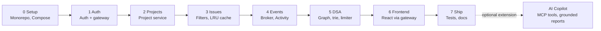
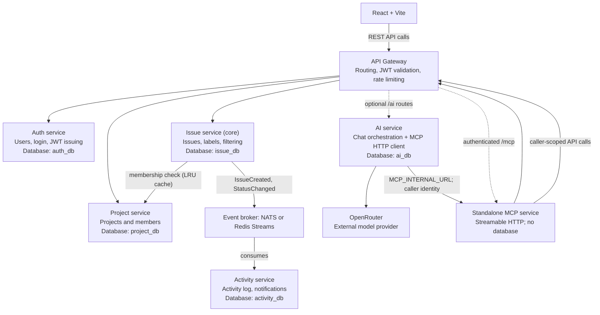
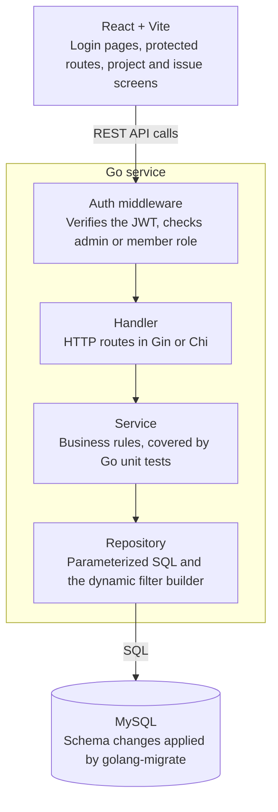

# Trackline Build Plan (Go microservices + MySQL + React)

The plan has two tracks. The **app track** is what you build, and the **assignment track** is what you document in each phase. Doing both together means your prompt history and context notes are written as you go, not reconstructed at the end.

## Workflow



Phases run in order: contracts and auth first, each service next, the frontend last, and every phase ends with its documentation.

## Services

The core tracker has an API gateway and four independently owned domain services. The optional AI Copilot is a separately deployable fifth service with its own database; it is an explicit Phase 7 extension, not a replacement for or prerequisite to the core tracker. AI chat is a Streamable HTTP client of the separately running, stateless MCP service. External MCP clients reach that service only through the authenticated Gateway.



| Service | Owns | Own database |
|---|---|---|
| API Gateway | Routing, JWT validation, rate limiting | none |
| Auth service | Users, login, roles, JWT issuing | `auth_db` |
| Project service | Projects, members, permissions | `project_db` |
| Issue service (core) | Issues, labels, filtering, search | `issue_db` |
| Activity service | Activity log, comments feed, notifications | `activity_db` |
| AI service (optional) | Read-only AI chat orchestration and user-owned transcript history | `ai_db` |

- **Database per service:** one MySQL container with separate databases is fine, but services never query each other's tables.
- **Sync calls:** gRPC or REST between services, for example the Issue service asking the Project service whether a user is a member.
- **Async events:** `IssueCreated` and `StatusChanged` go through a broker (NATS or Redis Streams), and the Activity service consumes them.
- **No cross-service joins:** the Issue service stores user IDs only, and names are enriched at the gateway or in the UI. Explain this choice in your architecture docs.
- **Optional AI boundary:** the AI service owns `ai_db`; only AI accesses its transcript tables. AI retrieves tracker data by calling allowlisted APIs through the Gateway, never by querying Auth, Project, Issue, or Activity databases.
- **AI's MCP boundary:** AI connects to the separately running `services/mcp` Streamable HTTP endpoint using `MCP_INTERNAL_URL`. It forwards the caller's bearer token, Gateway-verified user ID, and bounded request ID; the model provider receives neither credentials nor identity. Configure this URL only for a trusted private endpoint. GitHub tools remain local to AI and independently feature-gated.
- **Standalone MCP service:** `services/mcp` provides a bounded read-only tracker tool set. AI connects over the private endpoint (`http://mcp:8088/mcp` in Compose; loopback `http://127.0.0.1:8088/mcp` in the local process and Render deployments). External clients instead connect to the Gateway URL `/mcp` and provide a Trackline bearer token. The service has no database or GitHub App tools.

## Inside each service



Every service keeps the same four layers; the filter query builder in the Issue service's repository is the part to keep injection-safe.

## Professional practices

- Docker Compose to run everything with one command
- Config through environment variables, structured logging, and `/health` and `/ready` endpoints on every service
- OpenAPI specs (or `.proto` files for gRPC) kept in a `contracts/` folder
- GitHub Actions CI that runs lint, tests and build
- Unit tests plus a few integration tests for service-to-service calls
- Optional AI feature must be authenticated, read-only, bounded, and independently disableable when the provider is unavailable
- Graceful shutdown, request IDs passed across services, and timeouts on every outgoing call

## Data structures and algorithms

These come up in a real tracker. Make each one a small, tested package with benchmarks, and keep the first four if you need to trim.

| Data structure / algorithm | Where it fits |
|---|---|
| LRU cache (hash map + doubly linked list) | Caches project-membership checks so the Issue service does not call the Project service every time |
| Graph + cycle detection + topological sort | "Blocked by" issue dependencies: reject circular dependencies and show a valid work order |
| Trie | Autocomplete for labels and usernames |
| Token bucket (or sliding window) | Rate limiter in the gateway |
| Min-heap / priority queue (optional) | "Next issue to work on" ordered by priority and due date |
| Union-Find (optional) | Grouping duplicate issues |
| Keyset (cursor) pagination | A faster alternative to `OFFSET` for large issue lists |

## Phase 0: Setup and foundation

**App**

- Monorepo layout: `services/`, `gateway/`, `contracts/`, `pkg/` (shared logging, config, request IDs), `frontend/`, `db/migrations/`, `docs/`
- Docker Compose with MySQL (one database per service) and golang-migrate
- GitHub Actions CI running lint, tests and build
- A health-check template (`/health`, `/ready`) reused by every service

**Assignment**

- Write a root `CLAUDE.md` and `AGENTS.md`, plus one `AGENTS.md` per service
- Connect the MySQL and GitHub MCP servers and note the configuration
- Start `PROMPTS.md` with your initial prompt
- Record the model and settings in `MODELS-MCP.md`

**Done when:** Compose starts every container, CI is green, and the first commit is pushed.

## Phase 1: Auth service and gateway

**App**

- Register and login with bcrypt password hashing and JWT
- Roles: `admin` and `member`
- Gateway routing and JWT validation, passing the user ID to the services
- OpenAPI spec for both in `contracts/`

**Tables:** `users` in `auth_db`

**Assignment:** Create a `db-migration` skill. Run `/compact` at the end of this phase and note what you preserved.

## Phase 2: Project service

**App**

- Create, read, update, and delete projects
- Add and remove project members
- A membership-check endpoint (gRPC or REST) for other services
- Gateway routes for the project API

**Tables:** `projects`, `project_members` in `project_db`

**Assignment:** Draft `ARCHITECTURE.md` with the services diagram and record any debugging prompts.

## Phase 3: Issue service (the core)

**App**

- Issue CRUD: title, description, priority, status (todo / in progress / done), assignee, reporter
- Labels per project, with many-to-many assignment to issues
- Membership check through the Project service, with a timeout and an LRU cache
- Filter by status, assignee, priority, and label (including multiple labels), plus keyword search and sorting
- Keyset pagination, and a safe dynamic query builder with parameterized SQL and no string concatenation
- Indexes for the common filters

**Tables:** `issues`, `labels`, `issue_labels` in `issue_db`

**Assignment:** Add a `code-reviewer` subagent and use it on this phase. Use the MySQL MCP to inspect the schema and test queries. Record the injection-safety and slow-query prompts, then compact the context again.

## Phase 4: Events and Activity service

**App**

- Add the broker (NATS or Redis Streams) to Compose
- The Issue service publishes `IssueCreated` and `StatusChanged`
- The Activity service consumes them, stores the log, and serves an activity feed
- Request IDs passed across services, and graceful shutdown

**Tables:** `activity_logs` in `activity_db`

**Assignment:** Add the event-flow diagram to `ARCHITECTURE.md` and record the debugging prompts.

## Phase 5: DSA packages

**App**

- Dependency graph in the Issue service with cycle detection and topological sort
- Trie for label and username autocomplete
- Token-bucket rate limiter in the gateway
- The LRU cache from Phase 3 as its own tested package
- Optional: min-heap for "next issue" and Union-Find for duplicates
- Unit tests and benchmarks for every package

**Tables added:** `issue_dependencies` in `issue_db`

**Assignment:** Document each package and the prompts that produced it, and add an `api-docs` skill if you built one.

## Phase 6: React frontend through the gateway

**App**

- Login and register pages, protected routes, token storage
- Project list and create-project form
- Issue list, detail page, and create/edit form
- Filter bar with URL query params, and a Kanban board grouped by status (dropdown first, drag-and-drop only if time allows)
- Loading and error states, form validation, basic responsive layout

**Assignment:** Use the Playwright MCP to test the UI and document the result.

## Phase 7: Testing, observability, and final documentation

**App**

- Unit tests per service and a few integration tests for service-to-service calls
- Structured logs and timeouts checked on every outgoing call
- Seed script with demo data

### Optional extension: AI Copilot and MCP tools

This extension is optional and must not make the core tracker depend on an AI
provider. It describes the current implementation; it does not add or reorder a
core build phase.

```mermaid
sequenceDiagram
    actor User
    participant UI as React Copilot
    participant GW as Gateway
    participant AI as AI service
    participant LLM as OpenRouter
    participant MCP as Private standalone MCP service
    participant API as Owning tracker API
    participant DB as AI-owned ai_db
    User->>UI: Ask question / open saved chat
    UI->>GW: Authenticated chat or history request
    GW->>GW: Validate JWT; attach caller identity
    GW->>AI: Forward chat request
    alt Deterministic issue-count summary or chart
        AI->>GW: Request scoped project/issue/user counts with caller token
        GW->>API: Forward to owning APIs
        API->>API: Enforce caller/project permissions
        API-->>AI: Authorized aggregate data
        AI->>AI: Build factual text and typed chart data
    else Model-generated answer
        AI->>LLM: Send prompt (no bearer token)
        LLM-->>AI: Answer or bounded tool request
        opt Model requests tracker facts
            AI->>MCP: Streamable HTTP tool call + caller identity
            MCP->>GW: Call owning API with caller bearer token
            GW->>API: Forward authenticated request
            API->>API: Enforce caller/project permissions
            API-->>MCP: Bounded authorized evidence
            MCP-->>AI: Tool result as untrusted evidence
            AI->>LLM: Continue with evidence
            LLM-->>AI: Grounded answer
        end
    end
    AI->>DB: Save successful user/assistant turn
    AI-->>GW: Answer and optional typed chart data
    GW-->>UI: Response
```

- AI uses the official Go MCP SDK as a Streamable HTTP client of the separately
  running `services/mcp` process. Remote tool discovery supplies the model's
  function definitions; model tool calls are dispatched through that service.
  The internal MCP listener is private; external MCP clients use Gateway `/mcp`.
  Neither MCP component accesses a database.
- Initial tools are allowlisted, read-only project, issue, activity, and member
  lookups. Enforce caller authorization in owning APIs. Bound tool calls,
  rounds, arguments, output size, aggregate evidence, request size, and deadlines.
  Treat retrieved text as untrusted; do not let prompt content enable tools,
  widen access, or authorize writes.
- Keep the OpenRouter key server-side. Never send caller credentials to the
  model provider. Review provider data handling before sending tracker or GitHub
  evidence in production. AI may be disabled when the provider is unavailable.
- AI alone owns the `ai_db` transcript schema. Save successful turns per user,
  retain them for 90 days, support owner-only load/delete, and purge expired
  records hourly. Saved turns are shown in history but prior turns are not sent
  as model context by default.
- Resolve activity actor IDs through the Auth API before model use; show names
  or “Unknown user,” never raw actor IDs. Charts are deterministic and limited
  to source-backed issues marked done: project counts and alphabetical,
  unranked user counts. Label them as tracker status counts, not performance
  scores or evidence of quality/productivity/current work.
- Optional GitHub evidence is limited to explicitly issue-linked PRs in a
  project-configured repository. Metadata and bounded source-diff processing
  are separate opt-ins; the AI must not infer links or claim it reviewed more
  than the supplied evidence.
- Test tool allowlists, authorization/cross-project isolation, bounds and
  failures, prompt injection, credential non-disclosure, actor-name resolution,
  transcript ownership/retention/deletion, chart semantics, and frontend
  loading/error/history/chart behavior. Record provider/configuration and
  deployment limits in `docs/AI_INSIGHTS.md` and `docs/ARCHITECTURE.md`.

**Assignment (final pass)**

- Finish `README.md` with features, tech, setup, and run steps
- Complete `PROMPTS.md`, `docs/CONTEXT.md`, `AGENTS-SKILLS.md`, and `MODELS-MCP.md`
- Push everything and share the repo link

## Summary

| Phase | Focus | Priority |
|-------|-------|----------|
| 0 | Monorepo, Compose, CI, instruction files, MCP | Must |
| 1 | Auth service and gateway | Must |
| 2 | Project service | Must |
| 3 | Issue service, filtering, LRU cache | Must |
| 4 | Broker and Activity service | Must |
| 5 | DSA packages | Must (graph, trie, rate limiter), optional (heap, Union-Find) |
| 6 | React frontend | Must |
| 7 | Tests, observability, final docs; optional AI Copilot/MCP | Must (tests/docs), optional (AI service/provider integrations) |

**The minimum viable submission is every core phase above plus the documentation.** The min-heap, Union-Find, AI service, OpenRouter integration, and GitHub evidence are optional. If AI is enabled, treat it as an explicit Phase 7 extension and preserve the service-ownership, authorization, privacy, and unranked-reporting boundaries above.
