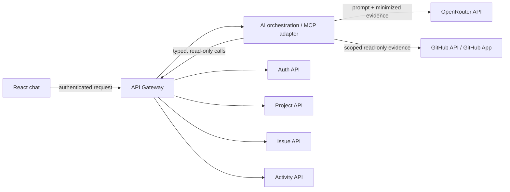

# AI chat and MCP insights plan

## Purpose

Provide admins, project managers, and team leads with a natural-language way to
understand project work: what is assigned, what changed, what appears complete,
and where follow-up may be needed. The AI feature is an **advisory reporting
tool**, not an authority that approves work or evaluates employees.

This is a proposed extension to the optional AI work in Phase 7 of
[`Trackline.md`](../Trackline.md). Complete the existing phases and their tests
and documentation first. The root instructions refer to
`Build_Plan_Bug_Issue_Tracker.md`, but that file is not present; `Trackline.md`
is the available roadmap and should be reconciled with that reference before
changing the canonical build plan.

The supplied [organization integration guide](https://admin-mi.stg.tseep.com/organization-integration-guide)
could not be retrieved while writing this plan. No assumptions about its
authentication or API contract are made here; review it before implementation.

## User stories

- As an authorized lead, I can ask for a project-scoped summary of open,
  recently completed, blocked, or overdue issues.
- I can ask what changed in a time window and see links or identifiers for the
  issues and activity records that support the answer.
- I can see who has assigned work and recent recorded contributions, with the
  reporting window and limitations made explicit.
- I can ask for potential risks or missing evidence, then verify the underlying
  records in the tracker.
- As a member, I can only ask about projects and data that I am authorized to
  access.

## Proposed architecture

The MCP adapter is a **proposed new deployable** and a deliberate exception to
the current architecture rule to keep the system at four services. Get that
trade-off approved before implementation. It has no tracker database and does
not become a source of truth. It accesses tracker data only through existing
service APIs (preferably via the Gateway), never by querying service tables.
Each service remains the owner of its data and authorization rules. Keep AI
orchestration separate from the Gateway's routing, JWT validation, and rate
limiting responsibilities.

The React chat should use the authenticated user session and the existing
Gateway. The orchestration layer should call a small allowlist of typed MCP
tools; initially, all tools are read-only and narrowly scoped:

| Tool | Inputs (bounded) | Data source | Purpose |
|---|---|---|---|
| `project_issue_summary` | project ID, optional status/assignee, date window | Issue API | Current issue counts and matching issue identifiers |
| `recent_project_activity` | project ID, time window, page size/cursor | Activity API | Recorded changes and activity evidence |
| `cross_project_done_task_summary` | authenticated caller | Project API + per-project Issue analytics API | Deterministic, unranked counts of issues currently marked done by assignee across projects the caller can access |
| `project_schedule_summary` | project ID, bounded date range | Project/Issue APIs as available | Due dates, milestones, and schedule context |
| `issue_details` | project ID and issue ID | Issue API | Verify a cited issue's current fields |
| `linked_pr_evidence` | project ID, issue ID | Issue API + GitHub API | Retrieve explicitly linked PR state, checks, and review evidence |
| server-side linked-PR code prefetch | exactly one explicit issue ID | Gateway/Issue/Project APIs + GitHub pull-request-files API | Optional bounded diff excerpts for explanation/review; server resolves and validates links rather than relying on model-selected retrieval |

Only expose tools supported by existing APIs. If a required field or endpoint is
missing, document that dependency and add the capability to its owning service
through its API contract; do not reach into its database. Use bounded
pagination, timeouts, and response sizes. Do not expose arbitrary SQL, generic
HTTP fetch, write, assignment, password, or account-management tools to the
model.

### GitHub evidence integration

GitHub data can help verify specific task evidence, but it cannot by itself
prove that work is correct or identify the “best” employee. A merged PR, passing
checks, and recorded review approval are evidence of those events only—not a
guarantee that requirements were met or that one individual was solely
responsible.

The AI service's in-process MCP adapter exposes the selected GitHub evidence
tool only when its GitHub App is configured. It uses the GitHub App/API rather
than giving the model a general-purpose credential or unrestricted GitHub MCP
server. Setup and deployment variables are documented in
[`github-app.md`](github-app.md).

- Connect only organization-approved repositories. Prefer a GitHub App
  installed on selected repositories with the minimum read-only permissions
  needed for pull requests and checks (and commit statuses only if required).
  The bounded diff feature uses the PR files endpoint and does not require
  Contents permission. Do not grant broader permissions than the feature needs.
- Keep installation credentials and short-lived tokens server-side. Never send
  tokens to OpenRouter or the browser, and never log credentials. Restrict outbound
  requests to GitHub's API and handle revocation, expiry, rate limits, and
  pagination.
- A project admin configures the repository connection through the Project
  service; the Project service owns that configuration. A user explicitly links
  a PR to an issue through the Issue service; the Issue service owns that link.
  Do not treat guessed links based on titles or descriptions as authoritative.
- Retrieve evidence on demand for an authorized question. Bound the number of
  PRs, pages, time range, response size, and request duration. Initially avoid
  storing GitHub payloads or adding webhooks; define freshness and retention
  requirements before doing so.
- Attribute PRs to tracker users only through an explicit, verified GitHub
  account-linking flow. Do not match display names or assume the issue assignee
  authored the PR. Support unlink/revocation and stop attribution when unlinked.
- State evidence precisely, with GitHub links and timestamps, e.g. “PR merged,”
  “observed checks passed at [time],” or “review approval recorded.” Do not say
  required checks passed unless the required-check policy is explicitly
  available and verified. Distinguish absent, stale, failing, conflicting, and
  unavailable evidence.
- Extend Project and Issue APIs/contracts for repository connections and
  issue-to-PR links if the existing APIs do not support them. The AI adapter
  calls those APIs and GitHub; it never reads service tables. Repository
  configuration belongs to Project, and PR links belong to Issue.
- Before production enablement, approve the App's installed-repository scope and
  OpenRouter processing of GitHub evidence. GitHub credentials being configured
  is not itself approval to send that evidence to the model provider.
- Code/diff processing is a separate opt-in (`GITHUB_CODE_TO_OPENROUTER`,
  default `false`) from metadata evidence (`GITHUB_EVIDENCE_TO_OPENROUTER`, also
  default `false`). Code review only receives bounded PR diff excerpts for
  explicitly linked PRs (up to five PRs and 10 files total; serialized evidence
  capped at 16 KiB). The excerpts are untrusted, may be truncated and
  secret-filtering is best-effort; do not use this to transmit highly sensitive
  or regulated source code without an approved provider/data-handling review.

### Model provider: OpenRouter

Use **OpenRouter** as the selected model provider. The Go orchestration layer
calls `https://openrouter.ai/api/v1/chat/completions` server-side, using
`OPENROUTER_API_KEY`; the React app must never call the provider directly or
contain the key. The initial model is
`nvidia/nemotron-3-ultra-550b-a55b:free`, selected by the project owner. Keep the
key and model name configurable through environment variables, with no secrets
committed. The request enables reasoning; test the model's tool-calling behavior
before relying on it for MCP orchestration.

OpenRouter is an external provider. Review its current data handling, free-tier
limits and availability, and provider routing before sending production issue,
comment, or GitHub content. Minimize evidence sent and keep the key server-side.
A `:free` model identifier does not guarantee availability, latency, or
unlimited usage.

## Data, evidence, and honest interpretation

The current tracker supports issue status/assignment, planned dates and
milestones, and recorded activity. Those records can support summaries, but they
do **not** prove that a task was completed correctly, measure accuracy, or
establish that a person is working right now. Activity volume and status changes
must not be presented as productivity or quality scores.

- Say **“recent recorded activity”**, not “currently working.” State the
  observation window and distinguish no recorded event from no work performed.
- Say an issue is **marked done** when that is all the source data establishes;
  do not claim it was validated or correctly completed.
- Cite supporting issue IDs, status, timestamps, and activity records in every
  material conclusion. Link to the UI where possible.
- State when evidence is absent, stale, incomplete, conflicting, or outside the
  requested time window. Do not turn missing data into a negative finding.
- Do not create a “top employee” ranking in the MVP. Counts can be distorted by
  task size, role, assignment practices, and incomplete event capture.
- The cross-project done-task summary reports counts alphabetically by username,
  not by count. It says “issues marked done,” separates unassigned issues, and
  does not identify a “top” user or characterize the counts as performance.
  Project scope is the set returned by the caller-authorized Project API; the
  Issue service returns per-project assignee aggregates only after its own
  membership check. If any project cannot be read, do not present partial totals.
- Do not use GitHub commits, PR counts, merges, reviews, or check results to
  rank or label individuals as the “best” or “most accurate.” These are
  incomplete, role-dependent proxies; authorship does not prove responsibility,
  and passing checks or approval is not proof of correctness. The MVP may show
  source-backed contributions and task evidence, with context and caveats, but
  must not output individual performance ratings.
- Any future quality/accuracy metric requires an explicit, human-defined
  acceptance/review signal, consistent capture, a documented formula, and
  approval from product and affected stakeholders. Show the raw evidence and
  uncertainty; do not infer an individual performance rating from AI output.

## Authorization, privacy, and model safety

- Propagate the caller identity and project scope through every request. Enforce
  the existing global-admin and Project service `admin`/`member` permissions on
  each data retrieval. Project admins are the current project-manager role;
  “team lead” is not a separate role and must be mapped to an existing role or
  explicitly designed before implementation. Never rely on the prompt or model
  to enforce access.
- Do not give the adapter a privileged service identity that can bypass the
  caller's access. Reject cross-project IDs and verify authorization before
  returning tool results.
- Treat issue descriptions, comments, and activity text as untrusted data and
  possible prompt injection. Delimit evidence as data; tool output cannot
  authorize new tools, access, or actions.
- Minimize data sent to a model: only include fields needed to answer. Exclude
  credentials, password/reset data, and unrelated personal data. Keep production
  model calls disabled until OpenRouter data handling, access controls, logging,
  and data retention are reviewed and approved.
- Do not persist chat transcripts by default. If persistence is later needed,
  define retention/deletion, access policy, encryption, and an owning datastore
  before adding it.
- Apply authentication, per-user/project rate limits, request and token limits,
  timeouts, audit metadata (actor, tool, project, time, outcome), and safe error
  handling. Never log prompts or sensitive source text by default.
- Make it clear in the UI that responses are AI-generated and must be verified.
  Do not allow the AI to mutate tracker records in the initial release.

## Delivery phases and exit criteria

These are feature sub-phases under the existing Phase 7; they do not replace or
reorder the main build plan.

Implementation note: the current tracker-only MVP uses an in-process MCP server
and client from the official Go SDK inside the AI service. The model's OpenRouter
tool calls are translated to MCP `CallTool` requests; MCP handlers use only
caller-authenticated Gateway APIs. This avoids adding a separately reachable
MCP service and keeps caller credentials scoped to the AI-to-Gateway requests.
The authenticated frontend now has an AI Copilot panel on the workspace (plus a
full-page entry) that posts to `/ai/chat`, shows loading and error states, and
warns users to verify results. The panel follows the Stitch board reference but
does not offer write/apply-suggestion actions. Each submission is independent:
prior turns are displayed locally but are not sent as context, and chats are not
persisted. GitHub tools and the unresolved external-provider approval are not
included in this implementation pass.

1. **Discovery and approval:** verify the organization integration guide;
   confirm user roles/scopes, approved GitHub repositories and permissions,
   account-linking approach, OpenRouter data-handling policy, and whether tracker
   or GitHub evidence may be processed by the external provider. Define exactly what “completion
   evidence” means. Exit when product/security approve a read-only MVP.
2. **Data/API readiness:** inventory existing Gateway and service endpoints,
   pagination, permission checks, event completeness, and GitHub API needs. Add
   project repository connections to the Project API and explicit issue-to-PR
   links to the Issue API if needed, with service-owned migrations/contracts.
   Exit when each insight has a source, permission rule, and evidence-freshness
   definition.
3. **Read-only MCP adapter:** implement allowlisted tracker and GitHub evidence
   tools, bounded input/output, caller-context propagation, deadlines, and
   audit metadata. No database of its own and no cross-service SQL. Exit with
   permission, token-handling, and tool-contract tests.
4. **Grounded chat UI:** add an authenticated chat experience through the
   Gateway, source citations, loading/error/empty states, and explicit
   uncertainty/missing-data language. Exit with UI and API tests.
5. **Pilot and evaluation:** test representative questions, authorization
   boundaries, stale/missing evidence, prompt injection, model failures, latency,
   and cost. Pilot with a small authorized group. Do not launch employee
   rankings or quality claims during the pilot.
6. **Evidence-based quality (future, separately approved):** if desired, design
   a human review/acceptance workflow and metrics with the responsible product
   stakeholders. Store any new review data only in the owning service, via its
   migration and API. Validate fairness, data completeness, and explanations
   before exposing aggregate measures; individual rankings need explicit
   governance approval.

## Testing and launch checklist

- Unit/contract tests for every MCP tool, input bounds, pagination, timeout,
  provider failure, and unsupported questions.
- Authorization tests for global admin, project admin (manager), project member, and
  unauthorized/non-member users; assert no cross-project data appears in
  tool results or answers.
- GitHub tests for installation-token expiry/revocation, repository scope,
  rate limits, pagination, linked-PR validation, account attribution, stale or
  missing evidence, and prevention of private data/token leakage.
- Tests that model output cites source records and labels missing/stale evidence
  rather than inventing facts. Include prompt-injection text in issue content.
- Frontend tests for loading, error, empty, citation navigation, and accessible
  chat controls.
- Verify no arbitrary SQL, writes, secrets in logs, transcript retention by
  default, or cross-service database access.
- Rate-limit and resource-usage tests, monitoring for tool errors/latency and
  provider cost, and an operational kill switch for model calls.
- Confirm provider data handling and the organization guide's integration
  requirements before enabling production traffic.

## Open decisions

1. Is an extra MCP/AI deployable approved despite the four-service limit?
2. What does the organization integration guide require for identity,
   authorization, and data access?
3. Is OpenRouter approved to process minimized issue, comment, and GitHub
   evidence? What limits and retention policy apply to its free model?
4. Are chats ephemeral, or is transcript history required? What are retention
   and deletion rules?
5. Which project roles may see team-level summaries, and should members see
   only their own assignments?
6. What human review/acceptance event would provide reliable completion-quality
   evidence, if quality metrics are later pursued? Individual employee ranking
   is explicitly out of scope unless separately governed and approved; AI
   inferences alone are not an acceptable quality measure.
