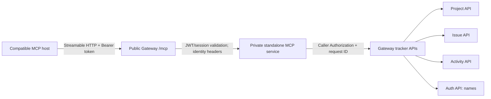

# Standalone Trackline MCP server

`services/mcp` provides a separate, stateless Streamable HTTP MCP endpoint for
read-only tracker access. Connect clients to the **Gateway URL** ending in
`/mcp` (for local Compose, `http://localhost:8082/mcp`) and configure the
client's HTTP Authorization header as `Bearer <Trackline access token>`. Do not
connect to the MCP container directly; it has no public port. The Gateway
validates the JWT and current session before proxying MCP requests.

The toolset is `list_projects`, `get_project`, `project_issue_summary`,
`list_project_issues`, `get_issue_details`, `recent_project_activity`, and
`list_project_members`. Calls use the caller's original bearer token against
Gateway APIs, so authorization remains with the owning services. Activity actor
IDs are resolved by Auth to usernames or `Unknown user`. The service has no
database, supports no writes, and includes no GitHub App tools. AI chat uses
this standalone service over private Streamable HTTP via `MCP_INTERNAL_URL`;
this is distinct from the public Gateway `/mcp` route for external MCP clients.
GitHub App tools remain local to AI. See [`AI_MCP.md`](AI_MCP.md) for AI
configuration and troubleshooting.

For a local full-app run, `make run-trackline` and `make run-backend` already
start MCP; do not run `make run-mcp` alongside either target. Run `make run-mcp`
separately only when launching the Gateway and tracker services through a setup
that does not already start MCP. Configure `GATEWAY_INTERNAL_URL`; use
`MCP_ADDR` to change the bind address. In deployment, route Gateway `/mcp` only
to the private MCP service. The Gateway checks the Trackline bearer token on
every MCP request, so clients must refresh or replace expired tokens.
Browser-based MCP clients also need their exact web origin added to
`CORS_ALLOWED_ORIGINS`; do not use a wildcard origin.

## Architecture

The MCP process is stateless and has no database or public listener. Gateway
validates the token/session on incoming MCP requests. The MCP process maps each
tool call to an authenticated Gateway API request; the owning API applies its
normal access rules. Activity/member results use Auth API name lookup rather
than exposing raw actor IDs or email addresses. AI chat connects directly to
this private service; external MCP clients use the Gateway route instead. Do
not configure AI to call the public Gateway `/mcp` endpoint.

## MCP protocol walkthrough

An MCP client first initializes a session and then discovers the available
tools with `tools/list`. The Go SDK handles initialization and JSON-RPC framing
for compatible clients. The list contains the seven names above, descriptions,
JSON input schemas, and read-only/idempotent annotations. A client invokes a
selected tool with `tools/call`; for example, `get_project` takes
`{"project_id": 42}` and returns the authorized API response as JSON text.
`list_projects` has no arguments. Tool calls are GET-only against tracker APIs
(name enrichment uses the Auth name lookup API); unknown tools/arguments and
oversized inputs/results are rejected. Issue lists are capped at 25 and activity
at 20 items. The server also bounds request and upstream time and response size.

For a protocol-level smoke check, use an MCP host/client that supports
Streamable HTTP, point it at `<gateway-origin>/mcp`, and configure the bearer
header through the host's protected secret mechanism. Discover tools, then call
`list_projects` and a `get_project` for an ID returned to that caller. Host
configuration formats differ; use the host's documented remote MCP URL/header
settings rather than connecting directly to port 8088. In browsers, allowlist
the exact origin in `CORS_ALLOWED_ORIGINS`.

The repository test `TestStreamableHTTPToolsAndCallerScopedRequest` uses the
official Go MCP SDK client to exercise protocol tool discovery and `get_project`
against test HTTP servers, including caller-token forwarding. This validates
the local implementation path, **not** a deployed Render instance or a separate
external AI host. No such external host/deployment test is claimed here.

## Current diagnostic note

`list_projects` is implemented as a caller-authenticated `GET /projects` call.
The reported accessible-project listing error on the deployed Render/Aiven
environment has not been reproduced or diagnosed; its cause remains unknown.
The local protocol test verifies a `get_project` call, not deployed project
listing or authorization behavior. Compare sanitized Gateway/MCP/API status
codes and request IDs when investigating; do not infer a cause from this test.
