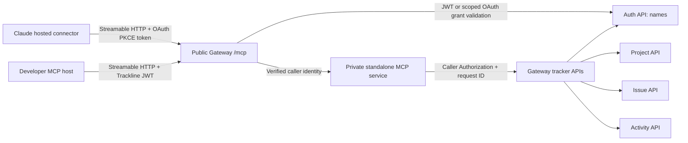

# Standalone Trackline MCP server

`services/mcp` provides a separate, stateless Streamable HTTP MCP endpoint for
read-only tracker access. Connect clients to the **Gateway URL** ending in
`/mcp` (for local Compose, `http://localhost:8082/mcp`). Do not connect to the
MCP container directly; it has no public port. Claude hosted connectors use
OAuth authorization code + PKCE through the Auth service. Claude Code may
continue to use a Trackline bearer token in its protected MCP configuration.

The toolset is `list_projects`, `get_project`, `project_issue_summary`,
`list_project_issues`, `get_issue_details`, `recent_project_activity`, and
`list_project_members`. Calls use the caller's original bearer token against
Gateway APIs, so authorization remains with the owning services. Activity actor
IDs are resolved by Auth to usernames or `Unknown user`. The service has no
database, supports no writes, and includes no GitHub App tools. AI chat uses
this standalone service over private Streamable HTTP via `MCP_INTERNAL_URL`;
this is distinct from the public Gateway `/mcp` route for external MCP clients.
GitHub App tools remain local to AI. See [`AI_MCP.md`](AI_MCP.md) for AI
configuration and troubleshooting.

For a local full-app run, `make run-trackline` and `make run-backend` already
start MCP; do not run `make run-mcp` alongside either target. Run `make run-mcp`
separately only when launching the Gateway and tracker services through a setup
that does not already start MCP. Configure `GATEWAY_INTERNAL_URL`; use
`MCP_ADDR` to change the bind address. OAuth issuer and resource URLs are
configured with `MCP_OAUTH_ISSUER_URL` and `MCP_RESOURCE_URL`; for local runs
they default to `http://localhost:8082` and `http://localhost:8082/mcp`. The
Gateway-to-Auth introspection secret must be a random value of at least 32
characters in `MCP_OAUTH_INTERNAL_SECRET`; use the same value in both services.
For local OAuth name enrichment, set a different random 32+ character
`MCP_USERNAME_LOOKUP_SECRET` shared by Gateway and the private MCP process.

## Claude hosted connector setup

Hosted Claude web/Desktop connectors cannot reach localhost. Deploy Trackline
behind public HTTPS, then configure Render's `MCP_OAUTH_ISSUER_URL` to the exact
public origin, for example `https://trackline-backend-rslk.onrender.com`. The
resource URL defaults to that origin plus `/mcp`; if you override it, it must
match the URL entered in Claude exactly. Render creates
`MCP_OAUTH_INTERNAL_SECRET` and `MCP_USERNAME_LOOKUP_SECRET` from the
Blueprint; when deploying without the Blueprint, set different strong random
32+ character secrets in the Render service environment.

After redeploying, verify these public endpoints:

```text
GET https://YOUR-GATEWAY/.well-known/oauth-protected-resource/mcp
GET https://YOUR-GATEWAY/.well-known/oauth-authorization-server
```

The first response's `resource` must exactly equal
`https://YOUR-GATEWAY/mcp`; the second must advertise PKCE `S256`, the
registration endpoint, and the OAuth endpoints. A request to `/mcp` without a
token should return `401` with a `WWW-Authenticate` header pointing to the
protected-resource metadata. `/ready` only checks Gateway/core readiness and
does not test MCP OAuth.

In Claude, remove the old failed Trackline connector and add a custom connector
with the public HTTPS `/mcp` URL. Choose automatic OAuth client registration
(DCR) if prompted; do not invent or enter a client ID. Claude will open the
Trackline sign-in/consent page. Sign in with your Trackline credentials and
approve the explicitly read-only `mcp:read` scope. Authorization uses PKCE,
short-lived access tokens, and rotating refresh tokens. Authorization codes
and refresh tokens are stored only as hashes in `auth_db`; Gateway introspection
checks the current account/grant on requests and restricts OAuth tokens to MCP and the exact
read-only API routes its tools use. Existing Trackline JWT clients remain
supported.

OAuth discovery, DCR, authorization, token and revocation endpoints are served
by Auth through the Gateway. Set a stable HTTPS issuer before connecting
Claude; changing it after client registration requires removing and re-adding
the connector. Browser login and consent require a valid TLS certificate.

## Architecture



The MCP process is stateless and has no database or public listener. Gateway
validates the Trackline JWT or introspects the scoped OAuth grant on incoming
MCP requests. OAuth access is further restricted to MCP and the read-only API
methods used by its tools. The MCP process maps each tool call to an
authenticated Gateway API request; the owning API applies its normal access
rules. Activity/member results use Auth API name lookup rather than exposing
raw actor IDs or email addresses. AI chat connects directly to this private
service; external MCP clients use the Gateway route instead. Do not configure
AI to call the public Gateway `/mcp` endpoint.

## MCP protocol walkthrough

An MCP client first initializes a session and then discovers the available
tools with `tools/list`. The Go SDK handles initialization and JSON-RPC framing
for compatible clients. The list contains the seven names above, descriptions,
JSON input schemas, and read-only/idempotent annotations. A client invokes a
selected tool with `tools/call`; for example, `get_project` takes
`{"project_id": 42}` and returns the authorized API response as JSON text.
`list_projects` has no arguments. Tool calls are GET-only against tracker APIs
(name enrichment uses the Auth name lookup API); unknown tools/arguments and
oversized inputs/results are rejected. Issue lists are capped at 25 and activity
at 20 items. The server also bounds request and upstream time and response size.

For a protocol-level smoke check, use an MCP host/client that supports
Streamable HTTP, point it at `<gateway-origin>/mcp`, and authenticate through
OAuth or the host's protected Trackline bearer-token mechanism. Discover tools, then call
`list_projects` and a `get_project` for an ID returned to that caller. Host
configuration formats differ; use the host's documented remote MCP URL/header
settings rather than connecting directly to port 8088. In browsers, allowlist
the exact origin in `CORS_ALLOWED_ORIGINS`.

The repository test `TestStreamableHTTPToolsAndCallerScopedRequest` uses the
official Go MCP SDK client to exercise protocol tool discovery and `get_project`
against test HTTP servers, including caller-token forwarding. This validates
the local implementation path, **not** a deployed Render instance or a separate
external AI host. No such external host/deployment test is claimed here.

## Current diagnostic note

### Connector logs on Render

If dashboard logs are inaccessible, use the [local HTTPS debug setup](MCP_DEBUG.md)
to reproduce the flow and view diagnostic events directly in your terminal.

Gateway and Auth emit structured stdout events named `connector request started`
and `connector request completed` for allowlisted OAuth/MCP routes. Render's
Web Service **Logs** view can display these application logs without paid HTTP
request logging. No feature flag is required; redeploy the updated backend.
Completion events include service, fixed route, status, duration, and request ID.
Auth also includes an allowlisted `oauth_error` category for OAuth error responses.
Bodies, headers, URL queries, redirect URLs, credentials, and tokens are not logged.

Make one fresh connection attempt, then inspect `/oauth/token` and `/mcp` events.
A token failure points to OAuth exchange; successful exchange followed by MCP
failure points to authorization/protocol handling. An initial unauthenticated MCP
401 can be normal discovery, so inspect the sequence rather than one status.
Gateway forwards its bounded request ID to Auth for correlation. Share only these
sanitized events, never browser payloads or token responses. A started event without
a completed event may indicate a still-open stream or interrupted process.

`list_projects` is implemented as a caller-authenticated `GET /projects` call.
The reported accessible-project listing error on the deployed Render/Aiven
environment has not been reproduced or diagnosed; its cause remains unknown.
The local protocol test verifies a `get_project` call, not deployed project
listing or authorization behavior. Compare sanitized Gateway/MCP/API status
codes and request IDs when investigating; do not infer a cause from this test.
